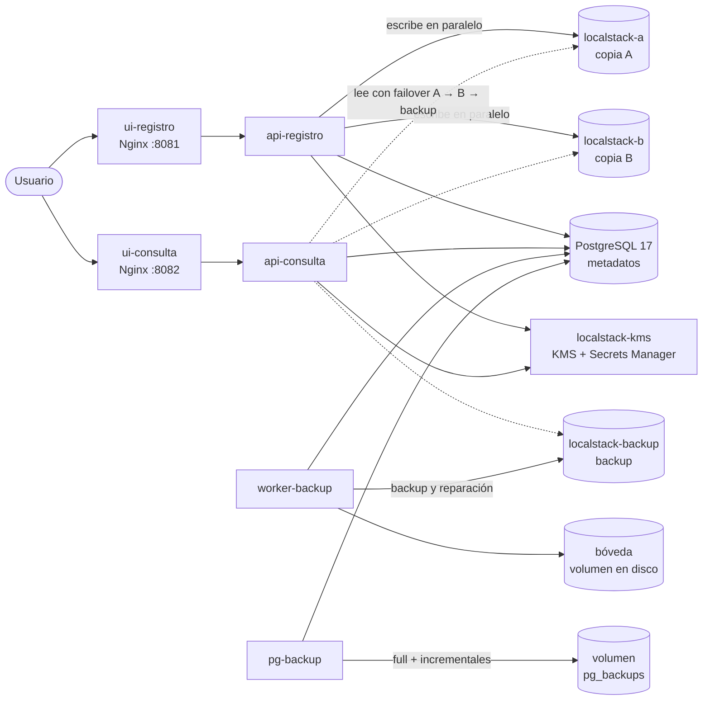

# PepiCloud – Gestión documental clínica distribuida

Prototipo de un sistema distribuido para almacenar documentos clínicos de pacientes con **alta disponibilidad, cifrado e inmutabilidad**. Desarrollado para el **Taller Práctico 2 de Sistemas Distribuidos** (CECAR, 2026-2).

El sistema permite registrar pacientes, cargar sus documentos (historias clínicas, laboratorios, imágenes diagnósticas, etc.) y consultarlos desde dos portales web separados. Cada documento se cifra antes de guardarse, se almacena en **dos copias activas y un backup independiente** sobre almacenamiento de objetos (S3 en LocalStack), y queda **protegido contra modificación o borrado durante 30 minutos**, incluso para un administrador.

---

## Contenido

- [Arquitectura](#arquitectura)
- [Cumplimiento de los requisitos del taller](#cumplimiento-de-los-requisitos-del-taller)
- [Requisitos previos](#requisitos-previos)
- [Instalación y puesta en marcha](#instalación-y-puesta-en-marcha)
- [Uso](#uso)
- [Operación diaria](#operación-diaria)
- [Pruebas](#pruebas)
- [Backups de la base de datos](#backups-de-la-base-de-datos)
- [Seguridad y manejo de secretos](#seguridad-y-manejo-de-secretos)
- [Estructura del proyecto](#estructura-del-proyecto)
- [Decisiones de diseño y limitaciones](#decisiones-de-diseño-y-limitaciones)

---

## Arquitectura



| Servicio | Puerto | Función |
| --- | --- | --- |
| `ui-registro` | 8081 | Portal web de registro de pacientes y carga de documentos |
| `ui-consulta` | 8082 | Portal web de consulta y descarga (solo lectura) |
| `api-registro` | interno | Cifra los documentos, los guarda en A y B y registra los metadatos; elimina con permisos |
| `api-consulta` | interno | Busca y descarga documentos con failover A → B → backup y *circuit breaker* |
| `worker-backup` | — | Cada 15 s: copia al backup y a la bóveda, verifica las copias y repara las perdidas |
| `localstack-a` | 4566 | Copia operativa A – bucket `pepicloud-docs-a` |
| `localstack-b` | 4567 | Copia operativa B – bucket `pepicloud-docs-b` |
| `localstack-backup` | 4568 | Backup documental – bucket `pepicloud-docs-backup` |
| `localstack-kms` | 4569 | Clave maestra de cifrado (KMS) y credenciales de BD (Secrets Manager) |
| `postgres` | 5432 | PostgreSQL 17: personas, metadatos, copias y auditoría (sin archivos) |
| `pg-backup` | — | Backup completo inicial e incrementales cada 10 minutos |
| `postgres-restore` | 5433 | Instancia para probar restauraciones (solo bajo demanda) |

Los puertos se publican solo en `127.0.0.1`. Las APIs no tienen puerto publicado: solo se accede a ellas a través de su portal.

### Organización de los objetos

Cada documento se guarda con la misma ruta en las tres copias:

```
<bucket>/<cédula>/<TIPO_DOCUMENTO>/<AAAA>/<MM>/<uuid>.<ext>.enc

pepicloud-docs-a/1102345678/HISTORIA_CLINICA/2026/11/1e667c0b-1692-44c0-b3e6-ac28a94e9b88.pdf.enc
```

---

## Cumplimiento de los requisitos del taller

| # | Requisito | Implementación |
| --- | --- | --- |
| 1 | Documentos asociados a personas, con interfaces de registro y consulta separadas | Dos portales Nginx independientes, cada uno con su propia API y su propio usuario de base de datos |
| 2 | PostgreSQL para metadatos, sin BLOB | Tablas `personas`, `tipos_documento`, `documentos`, `copias_documento` y `auditoria`; los archivos solo se referencian por su ruta |
| 3 | Dos copias activo-activo y un backup independiente | Escritura en paralelo en dos instancias LocalStack separadas; backup asíncrono en una tercera instancia, más una copia en disco (bóveda) |
| 4 | Recuperación ante pérdida o indisponibilidad de una copia | Lectura con failover y verificación de integridad; el worker reconstruye automáticamente las copias perdidas sin volver a cargar el archivo |
| 5 | Backup de la base: completo, incrementales, almacenamiento separado y prueba de restauración | `pg_basebackup` (full e incremental nativo de PostgreSQL 17) en un volumen propio; restauración con `pg_combinebackup` en una instancia aparte |
| 6 | Cifrado en reposo y credenciales fuera del código | Cifrado de sobre con KMS + AES-256-GCM; Docker secrets y Secrets Manager; nada sensible en Git ni en las imágenes |
| 7 | Inmutabilidad de 30 minutos, incluso para administradores | S3 Object Lock en modo COMPLIANCE, escritura condicional sin sobrescritura y trigger en PostgreSQL; eliminación posterior con token de administrador |
| 8 | Docker, PostgreSQL y LocalStack | Todo el sistema se levanta con `docker compose` |

---

## Requisitos previos

- **Windows 11 con WSL2 (Ubuntu)**, o Linux/macOS.
- **Docker Desktop** con la integración de WSL activada para Ubuntu (*Settings → Resources → WSL integration*), o Docker Engine con Compose v2.
- **Git**.
- **Al menos 8 GB de RAM disponibles para Docker** (son 11 contenedores, 4 de ellos LocalStack).
- **Token de LocalStack.** Desde marzo de 2026 la imagen exige autenticación. Cada integrante crea una cuenta gratuita (plan *Hobby*) en <https://app.localstack.cloud> y copia su token desde *Auth Tokens*.

> En Windows, trabajen **dentro del sistema de archivos de Ubuntu** (por ejemplo `~/proyectos`), no en `/mnt/c/...`: en el disco de Windows los permisos de ejecución no funcionan y Docker es mucho más lento.

---

## Instalación y puesta en marcha

```bash
# 1. Clonar el repositorio dentro de Ubuntu
mkdir -p ~/proyectos && cd ~/proyectos
git clone https://github.com/amaurys30/Pepicloud.git
cd Pepicloud

# 2. Generar las contraseñas, la clave maestra y el token de administrador (carpeta secrets/)
./scripts/generar_secretos.sh

# 3. Crear el archivo de configuración y poner el token de LocalStack
cp .env.example .env
nano .env          # LOCALSTACK_AUTH_TOKEN=<su-token>   (Ctrl+O, Enter, Ctrl+X)

# 4. Construir y levantar todo (la primera vez descarga ~2 GB de imágenes)
docker compose up -d --build

# 5. Esperar a que todo esté sano
sleep 90
docker compose ps
```

Todos los servicios deben aparecer `Up` y, los que tienen verificación de salud, `(healthy)`. `postgres-restore` no aparece porque solo se enciende para probar restauraciones.

Verificación rápida:

```bash
curl -s localhost:8081/api/salud; echo     # {"estado":"ok","servicio":"api-registro","retencion_minutos":30}
curl -s localhost:8082/api/salud; echo     # {"estado":"ok","servicio":"api-consulta","copias_marcadas_caidas":[]}
```

---

## Uso

| Portal | Dirección | Qué permite |
| --- | --- | --- |
| Registro | <http://localhost:8081> | Registrar pacientes, cargar documentos (PDF, JPG o PNG, máx. 20 MB), ver el estado de las copias y eliminar documentos |
| Consulta | <http://localhost:8082> | Buscar los documentos de un paciente por cédula, tipo y fechas, y descargarlos. Muestra desde qué copia se sirvió cada descarga |

**Eliminar un documento** requiere el token de administrador, que está en `secrets/api_admin_token.txt`:

```bash
cat secrets/api_admin_token.txt
```

Se pega en el campo *Token de administrador* del portal de registro. Durante los 30 minutos de retención la eliminación es rechazada (HTTP 423), incluso con el token.

---

## Operación diaria

```bash
docker compose up -d                  # encender todo
docker compose stop                   # apagar todo (conserva base, bóveda y backups)
docker compose ps                     # estado
docker compose stop <servicio>        # detener un servicio (por ejemplo, para simular una caída)
docker compose start <servicio>       # volver a levantarlo
docker compose logs --tail 30 <servicio>
docker compose logs -f worker-backup  # ver al worker trabajando (Ctrl+C para salir)
```

> ⚠️ **Nunca ejecuten `docker compose down -v`.** La opción `-v` borra los volúmenes: la base de datos, la bóveda y los backups.

Al encender, las copias A, B y backup vuelven vacías (LocalStack gratuito no persiste datos) y el worker las reconstruye automáticamente desde la bóveda en el primer minuto.

---

## Pruebas

| Prueba | Comando | Qué verifica |
| --- | --- | --- |
| Conectividad | `docker compose run --rm app-pruebas` | Las 3 copias (con Object Lock), KMS y Secrets Manager |
| Base de datos | `./pruebas/prueba_bd.sh` | Trigger de inmutabilidad y permisos por servicio |
| Cifrado | `docker compose run --rm app-pruebas python -m pruebas.prueba_cifrado` | Cifrado de sobre, detección de alteraciones |
| Clave maestra | `prueba_kms_persistencia` (ver el archivo) | Que un documento siga siendo legible tras recrear KMS |
| Almacenamiento | `docker compose run --rm -e RETENCION_MINUTOS=2 app-pruebas python -m pruebas.prueba_almacenamiento` | Escritura en A y B, Object Lock, sin sobrescritura, failover |
| Failover | `pruebas.prueba_failover` (ver el archivo) | Lectura con contenedores apagados de verdad |
| Conexión a BD | `docker compose run --rm app-pruebas python -m pruebas.prueba_bd_conexion` | Credenciales desde Secrets Manager y mínimo privilegio |

> Ejecuten las pruebas que suben objetos siempre con `-e RETENCION_MINUTOS=2`; si no, esos objetos quedan bloqueados 30 minutos.

---

## Backups de la base de datos

El servicio `pg-backup` hace un **backup completo** al arrancar por primera vez y luego un **incremental cada 10 minutos**, en el volumen `pg_backups`, que el contenedor de la base no puede ver.

```bash
docker compose exec pg-backup cat /backups/catalogo.txt          # backups realizados y de cuál depende cada uno
docker compose exec pg-backup respaldo.sh incremental            # hacer un backup ahora
docker compose exec pg-backup respaldo.sh full
```

**Probar la restauración** sin tocar producción:

```bash
docker compose --profile restore stop postgres-restore
docker compose exec pg-backup restaurar.sh                       # combina full + incrementales
docker compose --profile restore up -d postgres-restore          # base restaurada en el puerto 5433
docker compose exec postgres-restore psql -U pepicloud_admin -d pepicloud -c "SELECT count(*) FROM documentos"
docker compose --profile restore stop postgres-restore
```

Para restaurar a un momento anterior, se pasa el nombre del último backup a incluir: `restaurar.sh 20261102_171716_incremental`.

---

## Seguridad y manejo de secretos

| Secreto | Archivo (en `secrets/`, fuera de Git) | Quién lo recibe |
| --- | --- | --- |
| Contraseña del administrador de PostgreSQL | `pg_admin_password.txt` | `postgres` |
| Contraseña de replicación (backups) | `pg_replicador_password.txt` | `postgres`, `pg-backup` |
| Contraseñas de cada servicio | `pg_registro_password.txt`, `pg_consulta_password.txt`, `pg_worker_password.txt` | Se cargan en Secrets Manager; las APIs las leen de ahí |
| Material de la clave maestra KMS | `kms_key_material.txt` | `localstack-kms` |
| Token de administrador | `api_admin_token.txt` | `api-registro` |
| Credenciales AWS de LocalStack | `aws_credentials` | APIs y worker |
| Token de LocalStack | `.env` | Instancias LocalStack |

- Los secretos llegan a los contenedores como **Docker secrets** (archivos en `/run/secrets/`), no como variables de entorno.
- `.env` y `secrets/` están en `.gitignore`; solo se versiona `.env.example`.
- Cada servicio usa un **usuario de base de datos propio con permisos mínimos**: el de consulta solo lee y el worker no puede ver datos de pacientes.
- Los documentos se cifran con una **clave distinta por documento** (AES-256-GCM), que a su vez se cifra con la clave maestra de KMS.

> ⚠️ **`secrets/kms_key_material.txt` es la llave de todos los documentos.** Guarden una copia fuera del repositorio. Si se pierde, los documentos cifrados no se pueden recuperar.

---

## Estructura del proyecto

```
pepicloud/
├── docker-compose.yml
├── .env.example                     # plantilla de configuración (el .env real no se versiona)
├── scripts/
│   └── generar_secretos.sh          # genera todos los secretos en secrets/
├── secrets/                         # contraseñas y claves (no se versiona)
├── localstack/
│   ├── init-bucket.sh               # crea el bucket de cada instancia con Object Lock
│   └── init-kms.sh                  # clave maestra fija + secretos en Secrets Manager
├── db/init/                         # se ejecuta al crear la base por primera vez
│   ├── 00_roles.sh                  # usuarios por servicio
│   ├── 01_esquema.sql               # tablas, índices y triggers de inmutabilidad
│   ├── 02_permisos.sql              # mínimo privilegio
│   └── 03_datos_iniciales.sql       # tipos de documento
├── app/                             # imagen Python común (APIs y worker)
│   ├── Dockerfile
│   ├── requirements.txt
│   ├── comun/                       # configuración, AWS, cifrado, almacenamiento, BD, circuit breaker
│   ├── api_registro/main.py
│   ├── api_consulta/main.py
│   ├── worker_backup/main.py
│   └── pruebas/                     # pruebas de cifrado, almacenamiento, failover y BD
├── ui/
│   ├── nginx-registro.conf
│   ├── nginx-consulta.conf          # solo permite GET
│   ├── registro/index.html
│   └── consulta/index.html
├── pg-backup/
│   ├── Dockerfile
│   ├── respaldo.sh                  # full / incremental
│   ├── restaurar.sh                 # pg_combinebackup
│   └── programador.sh               # incrementales periódicos
└── pruebas/
    ├── prueba_bd.sh
    └── sql/prueba_bd.sql
```

---

## Decisiones de diseño y limitaciones

- **Backup asíncrono.** La API escribe A y B en paralelo; el backup lo hace el worker segundos después. Así, una caída de la instancia de backup no impide cargar documentos.
- **Bóveda en disco.** El plan gratuito de LocalStack no guarda datos al reiniciarse. Para que el backup sobreviva a reinicios, el worker guarda además una copia cifrada en un volumen de Docker. En AWS real no sería necesario, porque S3 guarda en disco.
- **Reparación automática.** El worker distingue una copia *inalcanzable* (instancia caída: espera) de una copia *perdida* (la instancia responde que no existe: la reconstruye). Nunca descifra: copia los bytes cifrados y verifica su huella.
- **Clave maestra reproducible.** LocalStack recrea KMS al reiniciarse; la clave se crea siempre con el mismo ID y material, guardado como secreto, para que los documentos sigan siendo legibles.
- **Failover rápido.** Se redujo el tiempo de resolución DNS a 1 s y la API de consulta recuerda durante 15 s qué copia está caída (*circuit breaker*): la primera descarga con una copia caída tarda ~3 s y las siguientes ~0,02 s.
- **Limitaciones conocidas:**
  - Todas las instancias corren en la misma máquina, que es un punto de falla común; en producción cada copia iría en un nodo o zona distinta.
  - El token de administrador es uno solo y compartido; en producción se usaría autenticación con usuarios y roles (OAuth/OpenID Connect).
  - La comunicación es HTTP porque todo es local; en producción sería HTTPS.
  - El token de LocalStack se pasa como variable de entorno, único mecanismo que LocalStack acepta.

---

## Autores

-Sofia Marcela Suancha Contreras
-Daniel Jimenez Salcedo
-Amaurys Castro De Arco

Taller Práctico 2 – Sistemas Distribuidos – CECAR, 2026-2.
